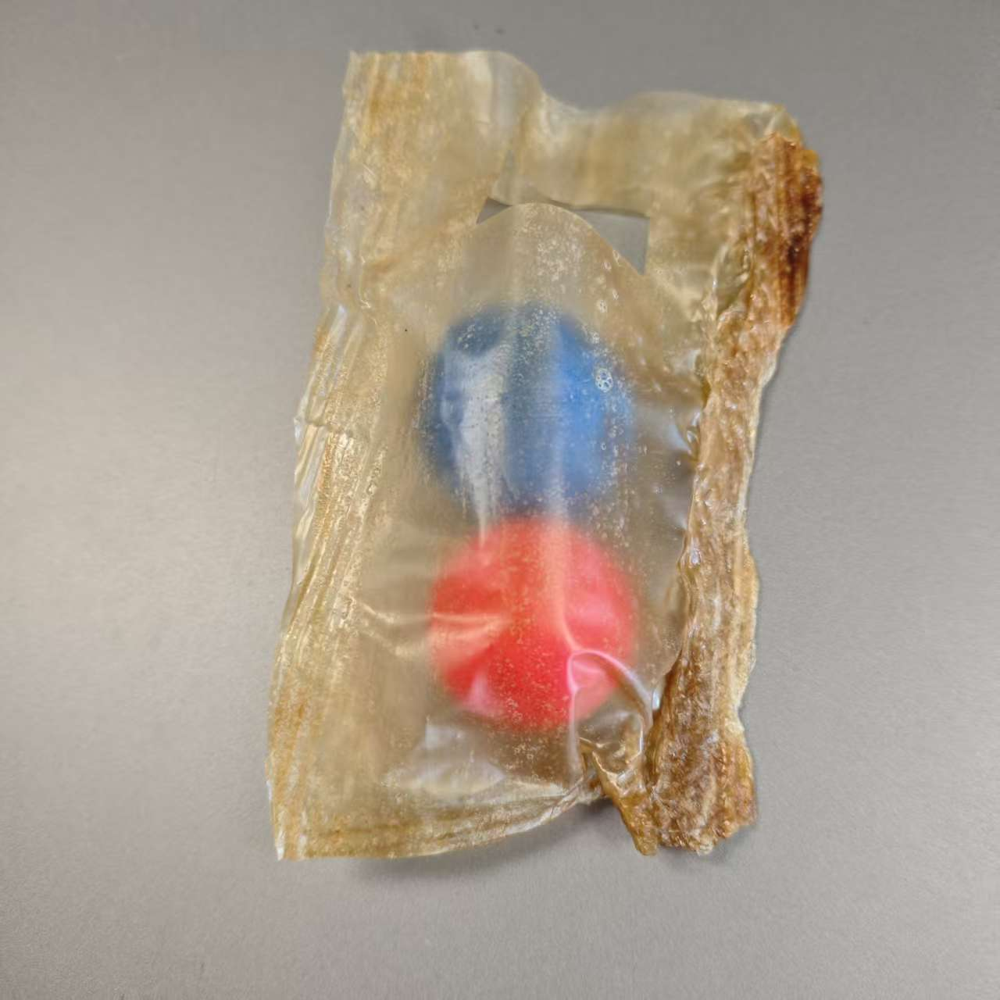
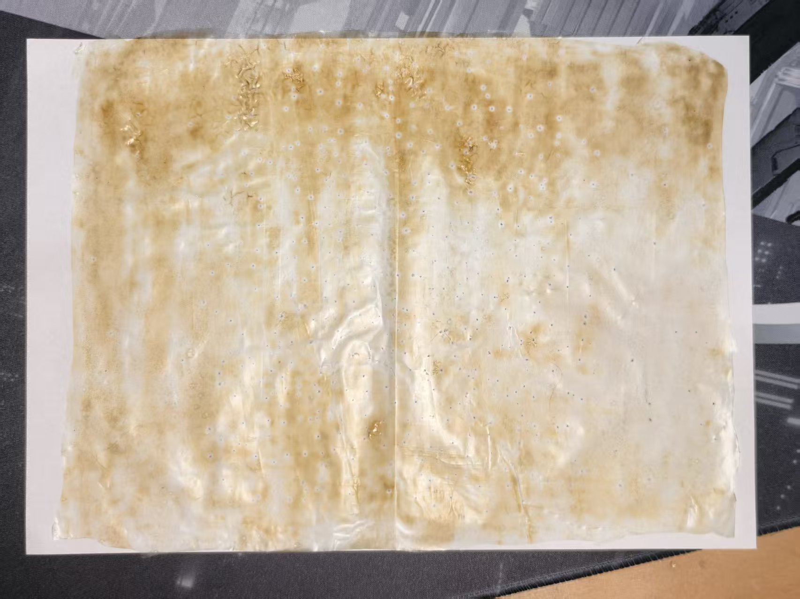
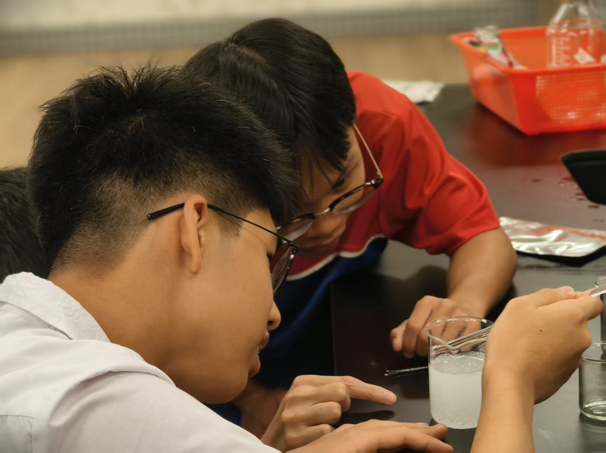
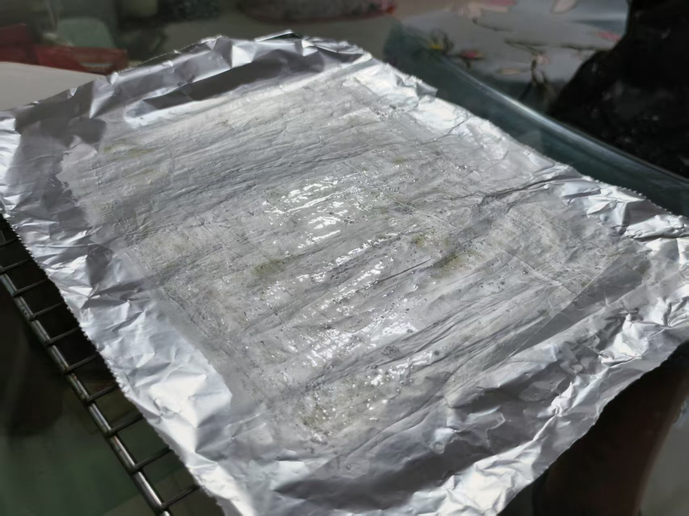
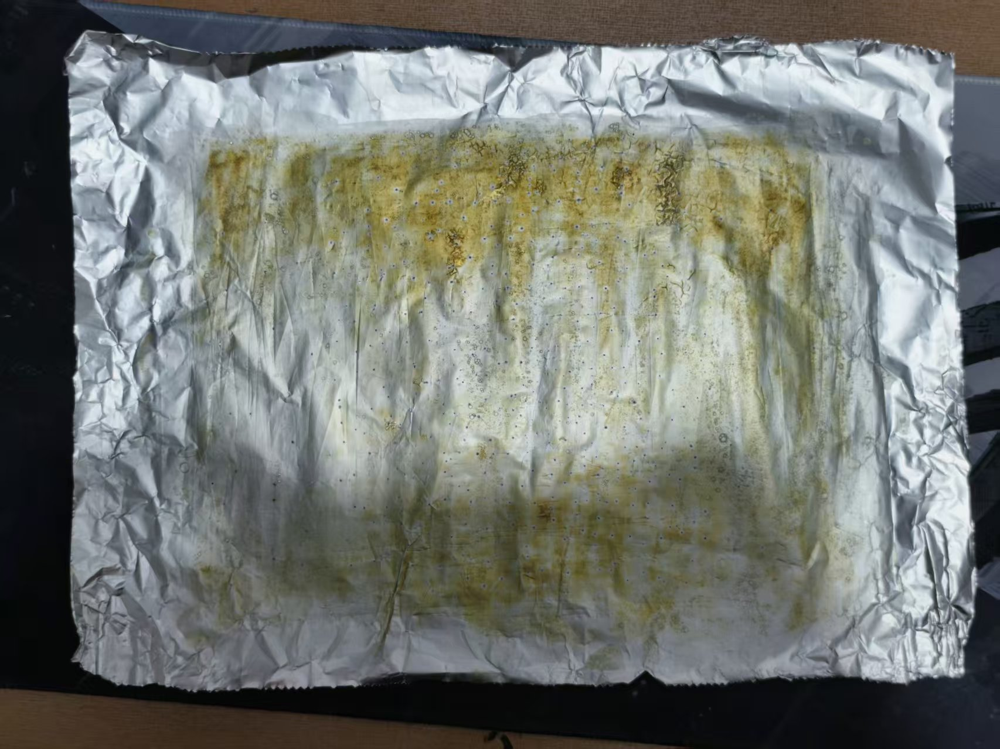
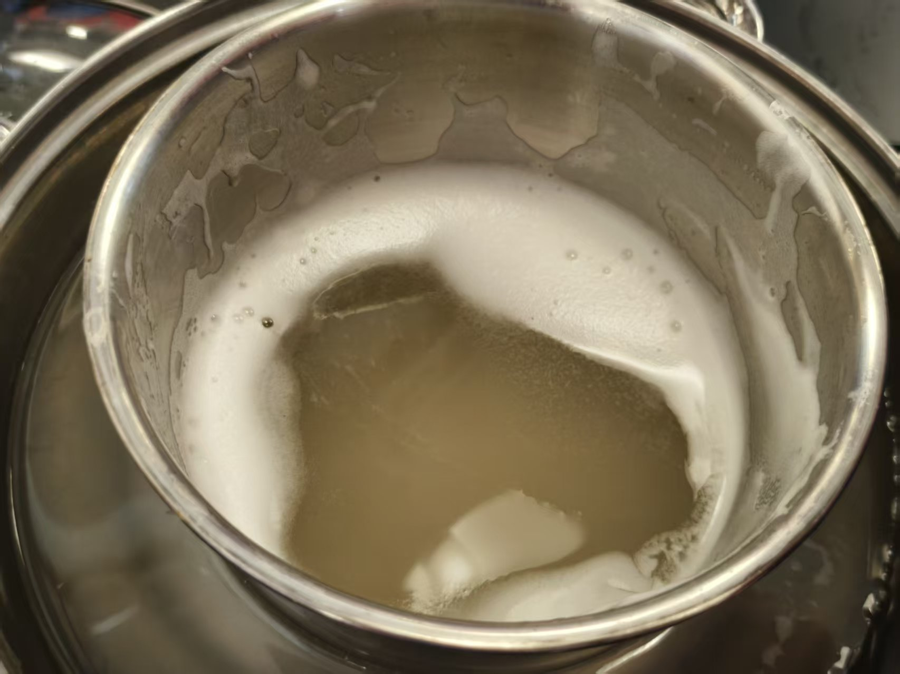

# 小龙虾壳制塑料袋：最终作品与研究资料

我们以商用壳聚糖、玉米淀粉、聚乙烯醇（PVA）和甘油制成复合薄膜，并完成袋样。这里记录项目成品、团队成员、制作过程和研究资料。



## 团队成员

李嘉鑫、林俊宇、张俊傑、梅俊鴻、莫欣睿、麥傑琳、黃語萱、程鑒濠

## 制作记录

以下照片按成果重要程度分组。成品和薄膜样品优先展示，成膜过程照片用于补充记录；人物和混合液照片不作为样品展示。

### 重点成果

| 袋样成品 | 薄膜样品 | 薄膜样品 |
| --- | --- | --- |
|  |  |  |

### 制作过程

| 摊铺成膜 | 薄膜干燥 | 袋样细节 |
| --- | --- | --- |
|  |  |  |

## 最终作品

- [项目简介（Markdown）](项目简介_公开.md)：作品说明、材料来源、制作流程、生化原理和环保反思。
- [制作过程和成品照片](photos/README.md)：照片说明与制作记录。
- `ppt_output/`：项目讲解演示文稿，文件名带 `v2` 的版本为后续版本。
- `qa_yield_video/视频产率复核.md`：引用演示视频的称量数据和计算口径复核。

本次制袋使用商用壳聚糖，未完成从小龙虾壳中提取壳聚糖的环节，也未验证食品接触安全或标准化降解性能。薄膜和袋样属于项目实验作品，不应作为食品包装使用；涉及加热、酸碱或实验室操作时应由老师指导并做好防护。

## 项目资料

| 资料 | 内容 |
| --- | --- |
| [项目资料总览](项目资料总览.md) | 项目目标、建议安排和资料索引 |
| [项目知识库](项目知识库.md) | 当前共识、证据地图和待解决问题 |
| [研究底稿](研究底稿.md) | 技术研究笔记、论文线索与实验方向 |
| [材料清单](商品壳聚糖膜与小袋材料清单.md) | 薄膜与小袋所需材料和工具 |
| `papers/` | 项目参考的论文原文和源文件 |
| `ppt_output/` | 项目讲解演示文稿 |
| `media/research-route.svg` | 从资料研究到实验验证的路径图 |

## 视频文件

演示视频由 Git LFS 管理。克隆仓库后请运行：

```bash
git lfs install
git lfs pull
```

## 使用与许可

仓库中的演示视频、论文原文和图片分别来自其原始来源，公开浏览或下载不代表这些第三方内容可自由转载或商用。使用前请核对相应来源和许可。本项目资料目前没有指定开源许可。
