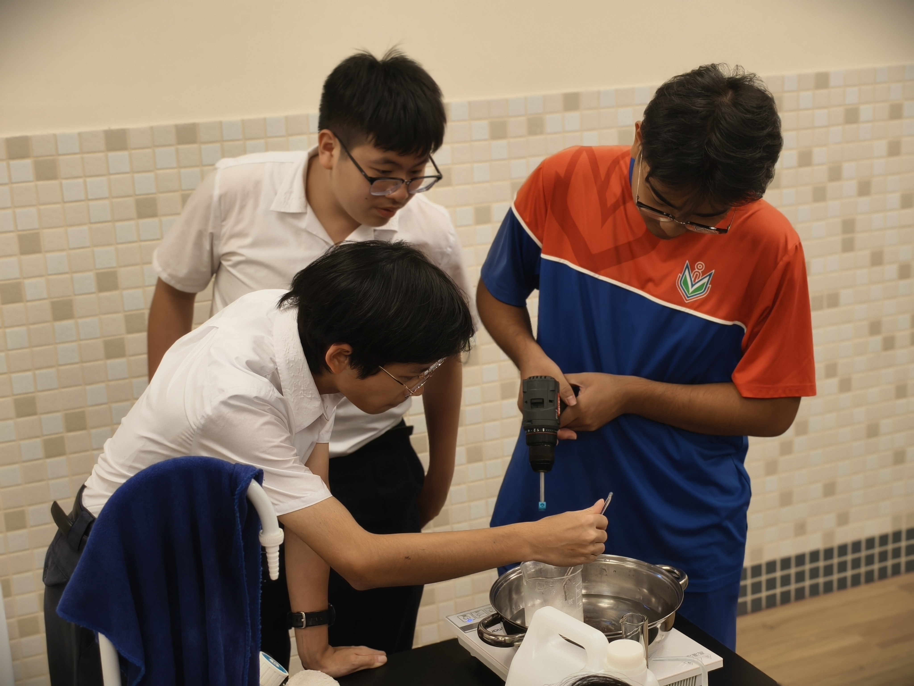
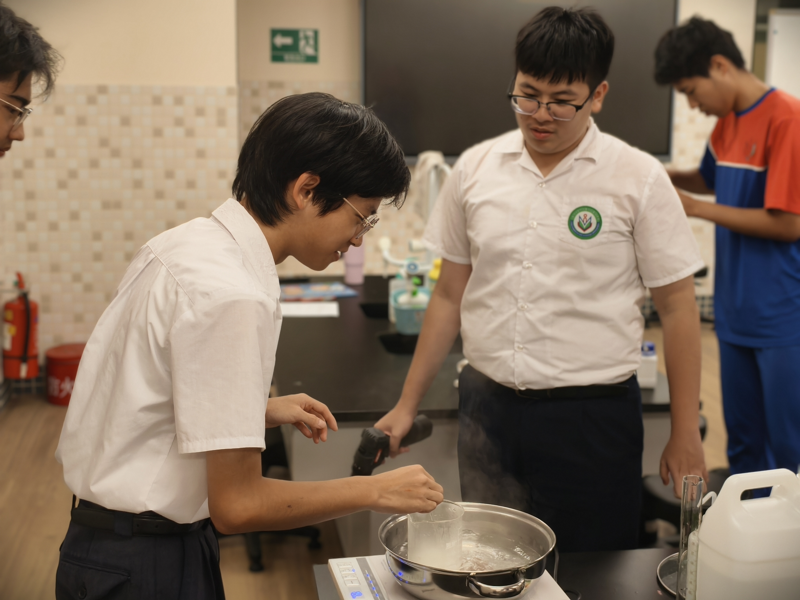
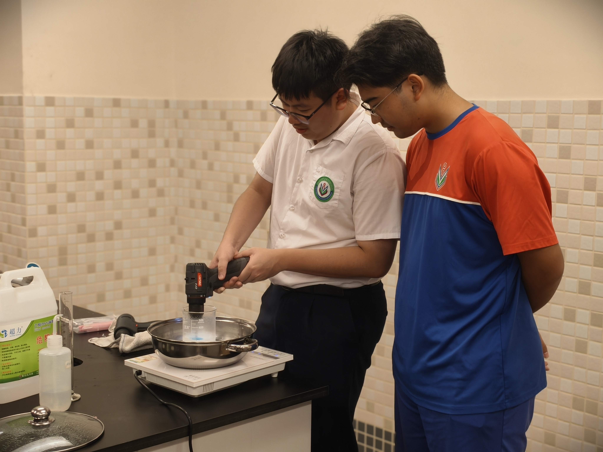

# 小龙虾壳制塑料袋：最终作品与研究资料

## 项目简介

本项目尝试使用壳聚糖、玉米淀粉、聚乙烯醇（PVA）和甘油制备复合薄膜，再将两张薄膜封边制成袋样，探索虾壳资源化材料用于制袋的可能性。本次制作使用的是商用壳聚糖，未进行从小龙虾壳提取壳聚糖的实验。

成品呈半透明、偏焦黄色，具有一定韧性；遇水后会变软并蜷缩。本项目记录材料配制、混合、成膜、干燥和封边过程，并结合观察讨论薄膜的成形和吸水表现。


## 团队成员

李嘉鑫、林俊宇、张俊傑、梅俊鴻、莫欣睿、麥傑琳、黃語萱、程鑒濠

## 项目图片

### 成品重点


### 薄膜样品


### 制作过程

| 摊铺成膜 | 干燥薄膜 | 混合完成后的溶液 |
| --- | --- | --- |
|  |  |  |

### 团队工作记录

| 团队工作照片 | 团队工作照片 | 团队工作照片 | 团队工作照片 |
| --- | --- | --- | --- |
|  |  |  |  |

## 最终作品

- [制作过程和成品照片](photos/README.md)：照片说明与制作记录。
- `ppt_output/`：项目讲解演示文稿，文件名带 `v2` 的版本为后续版本。
- `qa_yield_video/视频产率复核.md`：引用演示视频的称量数据和计算口径复核。

## 材料与制作流程

### 材料来源

本次使用商用壳聚糖、玉米淀粉、聚乙烯醇、甘油、醋酸、乙醇和水，没有使用回收虾壳或其他回收原料。后续计划探索从餐厨废弃小龙虾壳中提取壳聚糖，再评估其在薄膜中的应用。

### 制作流程记录

以下为第一轮尝试后整理的操作记录，供后续改进参考。第一轮未能成功，后续制作时对操作方法作了调整。

1. **配制溶液：**将 20 g 壳聚糖加入 360 mL 1% 醋酸溶液中搅拌溶解。另将 20 g 聚乙烯醇加入 10 mL 乙醇和 90 mL 水中，隔水加热并搅拌至溶解，再加入 10 g 甘油。聚乙烯醇较难溶解，宜加热搅拌；壳聚糖溶液可提前配制，醋酸气味较明显。
2. **糊化淀粉：**将 10 g 玉米淀粉加入 200 g 水中，隔水加热至约 100 °C，并持续搅拌至糊化；使用电动搅拌工具可帮助混匀。
3. **混合加热：**将壳聚糖溶液与塑化剂混合后加入淀粉糊，再加入由 20 g 淀粉和 200 mL 水调成的淀粉乳。在约 90 °C 水浴中持续搅拌至混合均匀，此处温度指水浴温度。
4. **成膜制袋：**将混合物薄层多次摊铺、烘干，每层约在 65 °C 烘干 10 分钟；取两张膜叠合并封合边缘，制成袋样。

## 生化原理与观察

壳聚糖、淀粉和 PVA 都是高分子，分子链间的氢键作用有助于形成薄膜；甘油作为增塑组分，使薄膜更柔软。亲水基团与水作用会使薄膜变软，吸水和膨胀不均可能使其卷曲。膜厚、干燥程度和封边结构也可能影响最终表现，具体原因仍需通过对照实验确认。

## 环保思考

本次未回收虾壳，也未验证薄膜的降解性。后续若能以废弃虾壳提取的壳聚糖替代部分新原料，可能促进副产物资源化；实际环境收益还需考虑提取、干燥和制膜所需的能源与材料。减少一次性袋使用并重复使用现有袋子，也是减少浪费的实际做法。

## 安全与验证边界

本项目没有验证食品接触安全，也没有进行标准化降解测试。薄膜和袋样是实验作品，不应作为食品包装使用。涉及加热、醋酸或其他酸碱以及实验室操作时，应在老师指导下进行并做好防护。

## 项目资料

| 资料 | 内容 |
| --- | --- |
| [项目资料总览](项目资料总览.md) | 项目目标、建议安排和资料索引 |
| [项目知识库](项目知识库.md) | 当前共识、证据地图和待解决问题 |
| [研究底稿](研究底稿.md) | 技术研究笔记、论文线索与实验方向 |
| [材料清单](商品壳聚糖膜与小袋材料清单.md) | 薄膜与小袋所需材料和工具 |
| `papers/` | 项目参考的论文原文和源文件 |
| `ppt_output/` | 项目讲解演示文稿 |
| `media/research-route.svg` | 从资料研究到实验验证的路径图 |

## 视频文件

演示视频由 Git LFS 管理。克隆仓库后请运行：

```bash
git lfs install
git lfs pull
```

## 使用与许可

仓库中的演示视频、论文原文和图片分别来自其原始来源，公开浏览或下载不代表这些第三方内容可自由转载或商用。使用前请核对相应来源和许可。本项目资料目前没有指定开源许可。
